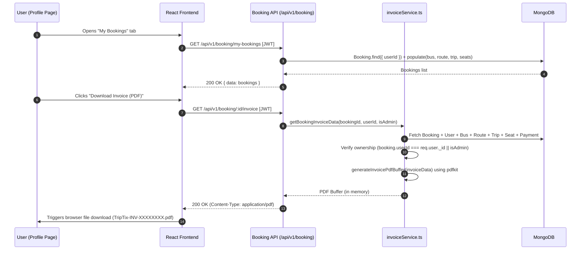

# Invoice & E-Ticket Generation Architecture (Option 1)

> **Project:** TripTix  
> **Scope:** Backend PDF Invoice & E-Ticket Generation + Razorpay Order `notes` + Frontend Download in Profile

---

## 1. Why We Chose Option 1 (And Why Not `razorpay.invoices.create()`)

A common misconception when integrating Razorpay is assuming `razorpay.invoices.create()` should be called *after* a payment succeeds to generate a receipt.

In reality:
1. **`razorpay.invoices.create()` is a payment collection tool**, not a post-payment receipt generator. It creates an *unpaid* invoice (`status: issued`) with a "Pay Now" link. You **cannot** attach an already-captured Razorpay Checkout `payment_id` to mark a newly created Razorpay Invoice as `paid`.
2. **Custom Bus Ticket Layout:** A bus ticket needs domain-specific fields — **Operator, Bus Number, Bus Type (AC/Sleeper), Route (`Origin -> Destination`), Journey Date, Departure/Arrival Time, Seat Numbers (`A1`, `B2`), and Passenger List** — which Razorpay's generic payment receipt does not format well.
3. **Works Everywhere:** Generating the PDF on our own backend works identically in **Test Mode**, **Live Mode**, and **offline local development** without depending on Razorpay's email/SMS delivery rules.

### Therefore, Option 1 combines the best of both worlds:
- **Razorpay Order `notes`:** Attach `busNumber`, `operator`, `route`, and `seats` to `razorpay.orders.create({ notes })` so Razorpay's dashboard and automated gateway receipts also carry trip context.
- **Backend PDF E-Ticket & Invoice (`pdfkit`):** Generate a branded, printable PDF invoice on demand from verified MongoDB records.

---

## 2. Architecture & Data Flow

---

## 3. Why Each Design Decision Was Made

### A. On-Demand In-Memory PDF Generation (Instead of Saving PDFs to Disk/S3)
- **Why:** Generating a 1-page PDF with `pdfkit` takes ~10–30ms in memory and returns a `Buffer` directly in the HTTP response.
- **Benefit:** Zero orphan files on the server disk, no extra S3/Cloudinary storage cleanup needed, and if a booking status changes (e.g., `confirmed` → `cancelled`), the downloaded invoice automatically reflects the latest state.

### B. Deep Mongoose `.populate()` Across Normalized Collections
Because TripTix separates physical layout from per-trip inventory and bookings, the invoice service joins 6 collections cleanly:
- `Booking` → `userId` (`Users`: name, email, phone)
- `Booking` → `busId` → `routesId` (`Buses` + `Routes`: operator, busNumber, times, origin, destination)
- `Booking` → `tripId` (`Trip`: departureDate)
- `Booking` → `seatIds` → `seatId` (`TripSeat` → `Seat`: `seatNumber`, `seatPreference`)
- `PaymentModel` (matched by `bookingId` or `razorpayOrderId`): `amountPaise`, `currency`, `razorpayPaymentId`

### C. Strict Ownership & RBAC Check (IDOR Prevention)
- Every `GET /:id/invoice` request checks `auth` middleware and verifies `booking.userId === req.user._id` (or `req.user.isAdmin`).
- No user can download another passenger's ticket or personal details by guessing a booking ID.

### D. Single Source of Truth for Amount Paid
- The invoice reads `amountPaise / 100` from `PaymentModel` first (falling back to `bus.price * seats.length` only if a legacy booking has no payment record). This guarantees the invoice total always matches what Razorpay actually charged.

### E. Dual Format Support (`PDF` + `?format=json`)
- `GET /api/v1/booking/:id/invoice` returns a downloadable `application/pdf` file by default.
- Adding `?format=json` returns the structured `InvoiceData` JSON, allowing future mobile apps or in-browser preview modals to render the invoice without parsing a PDF.

---

## 4. Implementation Status & Remaining Steps

### Already Built on Backend
1. **`pdfkit` + `@types/pdfkit`** installed in `TripTix-Backend`.
2. **`TripTix-Backend/src/services/invoiceService.ts`**:
   - `getBookingInvoiceData()` — deep population, ownership check, and structured `InvoiceData` assembly.
   - `generateInvoicePdfBuffer()` — renders the branded TripTix E-Ticket & Tax Invoice PDF in memory.
3. **`TripTix-Backend/src/routes/booking.ts`**:
   - `GET /api/v1/booking/my-bookings` — returns the logged-in user's bookings with bus, route, trip, and seat numbers.
   - `GET /api/v1/booking/:id/invoice` — streams the PDF (or JSON with `?format=json`).

### Remaining Work (When You Are Ready to Code)
1. **Razorpay Order `notes` (`TripTix-Backend/src/routes/payment.ts`):**
   - In `POST /create-order`, populate bus/route/seat numbers and pass them in `razorpay.orders.create({ ..., notes: { busNumber, operator, route, seats, tripId } })`.
2. **Frontend Bookings & Download UI (`TripTix/src/utils/constant.js` & `TripTix/src/pages/Profile.jsx`):**
   - Add `My_Bookings_API` and `Booking_Base_API` constants.
   - Fetch bookings in `Profile.jsx` and render them under the **"My Bookings"** tab with seat numbers, route, bus details, and a **"Download Invoice"** button (fetching with the `Authorization` header as a `Blob` and triggering download).
3. **(Optional) Email Delivery (`nodemailer`):**
   - After `fulfillPayment()` succeeds, attach the same `generateInvoicePdfBuffer()` output to an email sent to `user.email`.

---

## 5. Interview Follow-Up Questions & Model Answers

### Q1: Why generate the PDF in memory instead of saving it to disk or Cloudinary when the booking is created?
> **Model Answer:**  
> "For an invoice or e-ticket, on-demand generation in memory via `pdfkit` avoids storing thousands of static files and keeps the system stateless across multiple server instances. If a user later cancels their ticket, regenerating on demand automatically shows `CANCELLED` without needing to overwrite a stored PDF. If traffic grew very high, we could cache the generated PDF in S3/CDN after first generation."

### Q2: Why can't you just use `window.open('/api/v1/booking/:id/invoice')` on the frontend to download the PDF?
> **Model Answer:**  
> "Because `window.open()` or a plain `<a href>` tag cannot send custom HTTP headers like `Authorization: <JWT>`. Since the invoice contains PII (passenger names, phone, email), the endpoint is protected by JWT auth. On the frontend, we must use `fetch()` with the `Authorization` header, convert the response to a `Blob` (`res.blob()`), create a temporary object URL via `URL.createObjectURL()`, and trigger the download programmatically."

### Q3: How do you make sure Razorpay itself knows which bus and seats an order was for?
> **Model Answer:**  
> "We pass a `notes` object during `razorpay.orders.create()` containing `tripId`, `busNumber`, `operator`, `route`, and `seats`. That metadata is stored directly on Razorpay's order and payment records for customer support and reconciliation."
