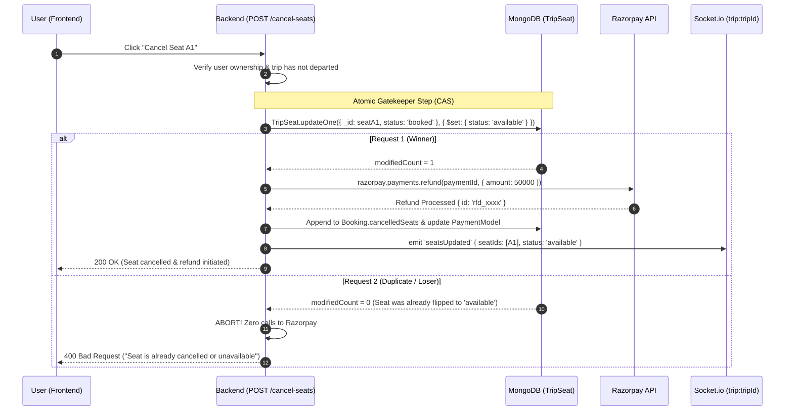

# Partial Seat Cancellation & Pro-Rata Refunds Architecture

> **Project:** TripTix  
> **Topic:** Per-Seat Cancellation, Razorpay Partial Refunds, Atomic Double-Refund Prevention & Real-Time Seat Release

---

## 1. Problem Statement: Why Partial Cancellation?

In standard booking systems, users frequently book tickets for small groups or families (e.g., 3 seats: A1, A2, A3). If one person drops out, forcing the user to cancel the **entire booking** creates terrible user experience:
1. The user loses their other confirmed seats.
2. If the bus is high-demand, rebooking the remaining 2 seats might fail because someone else snaps them up.
3. It incurs unnecessary payment processing costs and friction.

**The Solution:** Allow the user to select **individual seats** to cancel, receive an automatic pro-rata refund via Razorpay, maintain an intact audit trail for remaining passengers, and immediately release the cancelled seats back into the live inventory.

---

## 2. Refund Policy & Rules

| Policy Rule | Condition | Outcome |
| :--- | :--- | :--- |
| **Departure Check** | `trip.departureDate > new Date()` | **Allowed** — Cancellation permitted. |
| **Post-Departure Check** | `trip.departureDate <= new Date()` | **Blocked** — Cannot cancel seats for a trip that has already departed. |
| **Pro-Rata Math** | $\text{Per Seat Refund} = \frac{\text{Total Paid (paise)}}{\text{Total Original Seats}}$ | Exact proportional split based on actual amount charged. |
| **Fee Structure** | Current MVP: 100% Pro-Rata refund | Extensible to tiered fees (e.g., 90% if >24h, 75% if 12-24h). |

---

## 3. The Concurrency Threat: Double-Refund Race Condition

### The Problem (The "Check-Then-Act" Flaw)
If a user rapidly double-clicks "Cancel Seat" or network lag causes duplicate requests to reach the server 5ms apart:
```
Request 1: Reads DB -> Is Seat A1 booked? YES -> Calls Razorpay Refund (₹500) -> Updates DB
Request 2: Reads DB -> Is Seat A1 booked? YES -> Calls Razorpay Refund (₹500) -> Updates DB
```
**Result:** Razorpay processes **two refunds of ₹500** for a single ₹500 seat. The company loses money.

### The Cure: Atomic Compare-And-Swap (CAS)
Instead of checking first and taking action later, we make the database update the **gatekeeper** in a single atomic step:



### Why this guarantees 100% safety:
* MongoDB guarantees document-level write atomicity.
* Only the **first** request successfully matches `{ status: 'booked' }` and flips it.
* Any concurrent or subsequent request finds `status: 'available'`, matching 0 documents (`modifiedCount === 0`).
* If `modifiedCount === 0`, execution halts immediately. **Razorpay is never called.**

---

## 4. Compensating Transaction: What if Razorpay Fails?

What if Request 1 wins the atomic gatekeeper step (flips seat to `available`), but the Razorpay API call fails (e.g., network timeout or invalid payment state)?

In distributed systems, this is handled via a **Compensating Rollback**:
```ts
try {
  // Step 1: Atomic Gatekeeper
  const updated = await TripSeat.updateOne(
    { _id: seatId, tripId: booking.tripId, status: 'booked' },
    { $set: { status: 'available' } }
  );
  if (updated.modifiedCount === 0) {
    throw new Error('Seat is not currently booked.');
  }

  // Step 2: External Gateway Call
  const refund = await razorpay.payments.refund(paymentId, { amount: refundPaise });

  // Step 3: Record Audit Trail
  await recordCancellationSuccess(booking, seatId, refund);

} catch (err) {
  // Step 4: Compensating Rollback if Razorpay failed
  if (gatewayFailed) {
    await TripSeat.updateOne(
      { _id: seatId, tripId: booking.tripId, status: 'available' },
      { $set: { status: 'booked' } }
    );
  }
  throw err;
}
```
This ensures the seat is restored to `booked` if the money cannot be refunded.

---

## 5. Data Model Schema Design

### A. `Booking` Model Updates
Never delete cancelled seat IDs from the database. Instead, move them to an explicit audit array:

```ts
// Status lifecycle:
status: 'confirmed' | 'partially_cancelled' | 'cancelled'

// Audit log of cancellations:
cancelledSeats: [
  {
    seatId: { type: Schema.Types.ObjectId, ref: 'TripSeat', required: true },
    seatNumber: { type: String, required: true },
    passengerName: { type: String, required: true },
    refundAmountPaise: { type: Number, required: true },
    razorpayRefundId: { type: String, required: true },
    cancelledAt: { type: Date, default: Date.now }
  }
]
```

### B. `PaymentModel` Updates
Track the financial state of the payment:
```ts
status: 'pending' | 'completed' | 'failed' | 'partially_refunded' | 'refunded'
refundedAmountPaise: { type: Number, default: 0 }
refunds: [
  {
    razorpayRefundId: { type: String, required: true },
    amountPaise: { type: Number, required: true },
    seatId: { type: Schema.Types.ObjectId, ref: 'TripSeat' },
    createdAt: { type: Date, default: Date.now }
  }
]
```

---

## 6. Real-Time Socket Broadcast & UI Flow

1. **Immediate Seat Release:**
   When the cancellation completes, the backend emits to the trip room:
   ```ts
   global.io.to(`trip:${booking.tripId}`).emit('seatsUpdated', {
     tripId: booking.tripId.toString(),
     seatIds: [cancelledSeatId.toString()],
     status: 'available'
   });
   ```
   Users viewing the bus seat map see the seat turn green/available instantly in real time.

2. **Frontend UX (`Profile.jsx`):**
   - In **My Bookings**, bookings display:
     - Active seats (e.g., `A1, A3`)
     - Cancelled seats with a badge (e.g., `A2 [Cancelled & Refunded ₹500]`)
   - A **"Cancel Seats"** button opens a dialog with checkboxes for active seats.
   - User checks the seat(s) they wish to cancel, reviews the refund amount, and confirms.
   - If all seats in the booking are cancelled, the booking status transitions to `CANCELLED`.
   - Subsequent PDF invoice downloads automatically list active passengers and display the refund summary.

---

## 7. Interview Follow-Up Questions & Model Answers

### Q1: Why not run the Razorpay refund and MongoDB updates inside a single database transaction?
> **Model Answer:**  
> "A MongoDB transaction can only provide ACID guarantees across database operations within the database cluster. It cannot roll back an external third-party API call like Razorpay once HTTP packets have left the server. If MongoDB commits but the server crashes before Razorpay responds, or vice versa, you have an inconsistent distributed state. That is why we use the Compare-And-Swap (CAS) pattern to gate execution, call Razorpay, and execute a compensating transaction if the gateway fails."

### Q2: What happens if someone cancels an already refunded seat?
> **Model Answer:**  
> "Our query specifically filters by `{ _id: seatId, status: 'booked' }`. Once a seat has been cancelled, its status is `'available'`. Any subsequent call to cancel that same seat matches 0 documents (`modifiedCount === 0`), causing the endpoint to reject the request immediately without calling Razorpay."

### Q3: How does Razorpay handle multiple partial refunds against a single payment ID?
> **Model Answer:**  
> "Razorpay's `payments.refund` endpoint natively supports partial refunds. It maintains an internal ledger (`amount_refunded`). If a customer paid ₹1,500, we can issue a ₹500 refund today, and a second ₹500 refund tomorrow. Razorpay tracks the cumulative refunded amount and ensures total refunds never exceed the original captured payment."

### Q4: Why is soft-tracking cancellations in `cancelledSeats` superior to deleting the seat ID from `seatIds`?
> **Model Answer:**  
> "Financial compliance, customer support, and dispute resolution require an immutable audit trail. If we mutate `seatIds` by removing elements, we lose the record of who originally booked the seat, the timestamp of cancellation, and the exact `razorpayRefundId`. Storing cancellations in a dedicated subdocument preserves full historical context while accurately rendering updated invoices."
