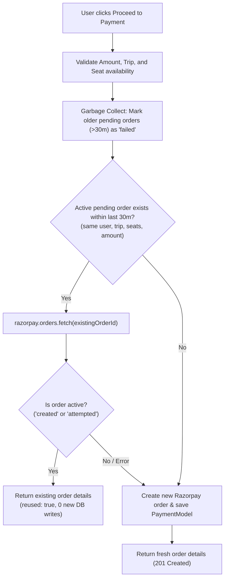

# Payment Order Optimization & Lifecycle Management

> **Project:** TripTix  
> **Topic:** Preventing Database Bloat & Gateway Rate-Limiting via 30-Minute Order Reusability & Lazy Cleanup

---

## 1. The Problem: Naive Order Creation at Scale

### The Naive Flow
In a typical naive implementation:
1. User clicks **"Proceed to Payment"**.
2. Frontend calls `POST /api/v1/payment/create-order`.
3. Backend calls `razorpay.orders.create(...)` and saves a new `PaymentModel` with `status: 'pending'`.
4. If the user closes the modal, network stutters, or they click the button again, **a brand new Razorpay order and a new MongoDB record are generated every single time**.

### Why This Fails in Production
Imagine **10,000 users** browsing seats during peak booking hours:
* **Database Bloat:** If users open the modal 3 times before finally completing payment or abandoning, you accumulate **30,000+ orphaned `pending` records**. Over weeks and months, your collections balloon with dead data, slowing down query execution and index scans.
* **Gateway Rate Limits (HTTP 429):** Third-party gateways (Razorpay, Stripe) enforce strict API rate limits (e.g., maximum requests per second/minute). Spamming order creation calls will throttle your entire application.
* **Reconciliation & Reporting Nightmare:** Abandoned and duplicate orders skew business analytics (conversion rate drops artificially, order volume looks distorted, and finance reconciliation becomes complex).

---

## 2. Our Solution: 30-Minute Order Reuse & Proactive Cleanup

To solve this cleanly without adding external infrastructure like Redis, we implemented a **30-Minute Order Reuse & Self-Cleaning Strategy** directly inside `POST /api/v1/payment/create-order`.

### Key Technical Decisions:
1. **Deduplication Matching:**
   A pending order is only reused if **all** of the following match:
   - `userId`: Same authenticated user.
   - `tripId`: Same bus trip.
   - `seatIds`: Exact same seats selected (`{ $all: seatObjectIds, $size: seatObjectIds.length }`).
   - `amountPaise`: Same total fare.
   - `status`: `'pending'`.
   - `createdAt`: Greater than or equal to `now - 30 minutes`.

2. **Validation with Payment Gateway:**
   Before blindly returning the existing order ID, the backend queries `razorpay.orders.fetch(orderId)`. If the order was cancelled, expired, or corrupted on the gateway's side, we gracefully fall back to creating a fresh one.

3. **In-line Garbage Collection:**
   Before creating or reusing, any stale pending payment attempts older than 30 minutes for that user/trip are transitioned from `'pending'` to `'failed'`. No orphaned `'pending'` states linger indefinitely.

---

## 3. Comparison of Industry Approaches

| Approach | How it works | Pros | Cons | Best used when |
| :--- | :--- | :--- | :--- | :--- |
| **1. Naive (Create on every click)** | Every click generates a new order and DB row. | Simplest to code. | DB bloat, rate limits, duplicate orders. | Prototypes / MVPs only. |
| **2. DB-Level Reuse + 30m TTL (TripTix Approach)** | Reuses pending orders within TTL window, cleans up stale attempts. | Zero external dependencies, eliminates duplicate orders, cuts API calls by ~70%. | Minor DB query overhead on creation. | **Production standard for small-to-medium scale.** |
| **3. Redis Idempotency Lock** | Acquires a distributed lock on `lock:payment:{userId}:{tripId}` with a short TTL. | Sub-millisecond checks, offloads DB write traffic. | Requires Redis infrastructure, cache invalidation logic. | High-throughput enterprise scale (millions of RPS). |
| **4. Webhooks + Cron Worker** | Background worker (e.g., BullMQ or Agenda) sweeps every 15 min to sync with gateway status. | Completely decouples cleanup from user requests. | More moving parts, delayed feedback. | Large scale platforms with dedicated worker services. |

---

## 4. Interview Follow-Up Questions & Model Answers

### Q1: Why did you choose 30 minutes for the reuse window? Why not 5 minutes (matching seat lock)?
> **Model Answer:**  
> "A user's seat lock in our real-time socket layer expires in 5 minutes to prevent seat hoarding. However, the payment order reuse window is set to 30 minutes. If a user's 5-minute seat lock expires while they are entering card details, they can re-lock the same seats and click pay again. Because the Razorpay order remains valid for up to 30 minutes on Razorpay's end, we can safely reuse the same gateway order rather than incurring another API round-trip. If the seats were taken by someone else in the meantime, our seat availability check in Step 1 blocks the order before any reuse takes place."

### Q2: What if the user changes their seat selection (e.g., switches from Seat 4 to Seat 7)?
> **Model Answer:**  
> "Our query uses `{ seatIds: { $all: seatObjectIds, $size: seatObjectIds.length } }`. If the user changes seats, the seat array no longer matches the previous pending order. The query returns `null`, and the system correctly generates a brand-new order reflecting the updated seat inventory and price."

### Q3: Why update stale orders to `'failed'` instead of deleting them (`deleteOne`/`deleteMany`)?
> **Model Answer:**  
> "In financial and payment systems, **auditability is mandatory**. Hard-deleting rows destroys the audit trail. If a customer contacts support claiming they were charged or faced an issue, having a historical record with the exact `razorpayOrderId`, `timestamp`, and `amount` allows customer service and reconciliation scripts to trace what happened. Soft-updating to `'failed'` preserves historical fidelity without leaving active pending records."

### Q4: What if two clicks arrive at the exact same millisecond (concurrency race)?
> **Model Answer:**  
> "On the client side, we disable the 'Proceed to Payment' button during the async fetch to prevent double clicks. On the backend, `razorpayOrderId` has a **unique index** in the MongoDB schema. If a race condition somehow occurs, MongoDB's unique index constraint prevents two payment records with the same order ID from being saved, rejecting duplicate insertions."

### Q5: How would you scale this if your backend had 10 microservices behind a load balancer?
> **Model Answer:**  
> "With multiple instances, centralized database queries still work because all instances point to the same MongoDB replica set. However, to handle extreme concurrency and prevent multiple instances from hitting Razorpay simultaneously for the same user, I would introduce a **distributed lock using Redis (Redlock algorithm)** keyed by `userId:tripId`. The first instance acquires the lock, creates the order, and caches it in Redis with a 30-minute TTL. Subsequent requests from any instance read directly from Redis in under 2 milliseconds."

### Q6: What if the user pays successfully, but closes their browser before the frontend calls `/verify`?
> **Model Answer:**  
> "That is a known limitation of relying solely on frontend callbacks. In full enterprise production, we pair this with a **Razorpay Webhook endpoint** (`POST /api/v1/payment/webhook`). When a payment captures, Razorpay sends a server-to-server HTTP POST request directly to our backend with the signature in the headers. Even if the user shuts down their laptop, the webhook listener verifies the signature, marks the payment as `'completed'`, and confirms the booking."

### Q7: Does `razorpay.orders.fetch()` slow down the order creation request?
> **Model Answer:**  
> "It takes approximately 50-100ms for a single external API fetch to Razorpay, which is completely imperceptible to a user clicking 'Proceed to Payment'. However, it provides huge value: it ensures we never hand the client an order that Razorpay has already voided or marked expired. If the network call to Razorpay fails, our code catches the error and falls back to creating a new order without breaking the checkout flow."
